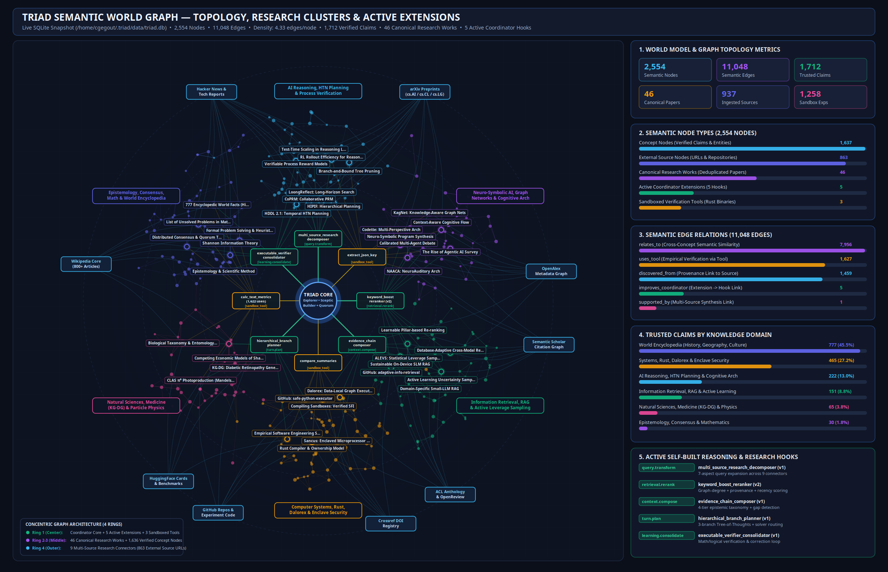

# Triad: Persistent, Self-Improving Three-Agent Autonomous Research Lab (`v0.3.0`)

[](Cargo.toml)
[](LICENSE)
[](Cargo.toml)
[-success.svg)](#7-sandboxed-tool--program-solver-execution)

**Triad** is a local, persistent, self-improving autonomous research community composed of three governing agents—**Explorer**, **Sceptic**, and **Builder**—augmented by bounded temporary **Specialists**, implemented in native Rust.

> **Shared Mission:**  
> *“Discover and understand AI research, develop better reasoning methods, and build extensions that increase our ability to investigate, experiment, and learn. Apply what we discover to improve our own operational capabilities.”*

Triad operates out of the box on local OpenAI-compatible inference snaps (`smollm3-3b` and dedicated `nomic-embed-text-v1-5` 768-D embeddings) while supporting optional, strictly budget-governed escalation to frontier providers (`Anthropic`, `OpenAI`, `Gemini`, `OpenRouter`). It investigates across **19 scientific, metadata, venue, code/artifact, institutional, orientation, and web-fetch connectors** with pure-Rust full-text extraction (`arxiv.org/html`, `ar5iv`, gzipped/tarred LaTeX e-print archives, and PDF streams), enforces a **two-phase specialist state machine** and **spec-driven experimental tool verification**, maintains a provenance-deduplicated **Semantic World Graph** in SQLite (WAL mode), and continuously evaluates its domain competence against external benchmarks.

---

## Table of Contents

1. [System Architecture & Module Map](#1-system-architecture--module-map)
2. [Constitutional Governance, Personalities & Enforced Specialist State Machine](#2-constitutional-governance-personalities--enforced-specialist-state-machine)
3. [Versioned Coordinator Extension Interface (5 Operational Hooks)](#3-versioned-coordinator-extension-interface-5-operational-hooks)
4. [Autonomous Reasoning Programme & Meaningful Research Experiments](#4-autonomous-reasoning-programme--meaningful-research-experiments)
5. [Deep-Research Pipeline, 19-Connector Adapter Interface & Pure-Rust Full-Text Extraction](#5-deep-research-pipeline-19-connector-adapter-interface--pure-rust-full-text-extraction)
6. [Model Providers, Capability Selection & Atomic Frontier Budgets](#6-model-providers-capability-selection--atomic-frontier-budgets)
7. [Domain Expertise Evaluation & Expertise Profile (`CLI` & `MCP`)](#7-domain-expertise-evaluation--expertise-profile-cli--mcp)
8. [Semantic World Graph & Knowledge Model](#8-semantic-world-graph--knowledge-model)
9. [Sandboxed Tool & Program-Solver Execution](#9-sandboxed-tool--program-solver-execution)
10. [Prerequisites, Installation & Inference Services](#10-prerequisites-installation--inference-services)
11. [Quickstart & Complete CLI Reference](#11-quickstart--complete-cli-reference)
12. [Systemd User Service Integration](#12-systemd-user-service-integration)
13. [Test Suite & Verification (54 Tests)](#13-test-suite--verification-54-tests)
14. [MIT License](#14-mit-license)

---

## 1. System Architecture & Module Map

```
                   +---------------------------------------------------+
                   |          triad CLI & MCP Server Interface         |
                   +-------------------------+-------------------------+
                                             | UNIX Domain Socket IPC / Streamable HTTP
                                             v
+---------------------------------------------------------------------------------------+
|                                     triad Daemon                                      |
|                                                                                       |
|  +-------------------------+  +-------------------------+  +-----------------------+  |
|  |     Explorer Agent      |  |      Sceptic Agent      |  |     Builder Agent     |  |
|  | (Hypotheses, Discovery) |  | (Verification, Dissent) |  | (Rust Tools & Exts)   |  |
|  +------------+------------+  +------------+------------+  +-----------+-----------+  |
|               |                            |                           |              |
|               +----------------------------+---------------------------+              |
|                                            | 2-of-3 Constitutional Quorum             |
|                                            v                                          |
|  +---------------------------------------------------------------------------------+  |
|  |                         Triad Coordinator & Hook Pipeline                       |  |
|  |  [query.transform] -> [retrieval.rerank] -> [context.compose]                   |  |
|  |                    -> [turn.plan]        -> [learning.consolidate]              |  |
|  +-----------------+-------------------------------+-------------------------------+  |
|                    |                               |                                  |
|     +--------------v---------------+ +-------------v---------------+ +-------------v--+
|     |   Shared Store (SQLite WAL)  | |  Sandboxed Execution (bwrap)| | 19-Connector   |
|     | - Claims, Votes & Dissent    | | - Two-Phase Specialist Exec | | SourceAdapter  |
|     | - Versioned Tracked Sources  | | - Spec-Validated Rust Tools | | - HTML/ar5iv   |
|     | - Immutable Exec Evidence    | | - Extension Runner (v1 JSON)| | - Safe tar.gz  |
|     | - Frontier Budget Ledger     | | - Process-Group Cleanup     | | - Pure-Rust PDF|
|     | - Domain Topic Coverage      | | - Shared Cargo Target Cache | | - Citation APIs|
|     +------------------------------+ +-----------------------------+ +----------------+
+---------------------------------------------------------------------------------------+
```

### Source Code Structure (`src/`)

| Module | File | Responsibility |
| :--- | :--- | :--- |
| **CLI & Daemon Entry** | [`src/main.rs`](src/main.rs) | CLI subcommand dispatcher (`status`, `learning`, `sources`, `experiments`, `models`, `profile`, `evaluate`, etc.), daemon lifecycle, and `triad doctor` diagnostics. |
| **Coordinator Engine** | [`src/coordinator.rs`](src/coordinator.rs) | Domain-independent autonomous curiosity loop, topic coverage prioritization, 5-hook extension pipeline, two-phase specialist orchestration, spec-driven tool synthesis, and self-repair engine. |
| **Extension Subsystem** | [`src/extensions.rs`](src/extensions.rs) | Versioned extension protocol (`v1`), sandboxed JSON runner, shared-target Cargo compilation, evaluation, quorum endorsement, atomic activation, and automatic rollback. |
| **Multi-Source Web & Extraction** | [`src/web.rs`](src/web.rs) | 19 research connectors (`SourceAdapter`), URL canonicalization, pure-Rust PDF (`lopdf`/`pdf-extract`) & in-memory `tar.gz` LaTeX extraction (`flate2`/`tar`), and extraction fidelity scoring. |
| **Persistent Semantic Store** | [`src/store.rs`](src/store.rs) | SQLite WAL store for `claims`, `tracked_sources`, `source_sections`, `source_corroborations`, `tool_executions`, `experiment_specifications`, `research_experiments`, `frontier_budget_ledger`, `evaluation_runs`, and `domain_topic_coverage`. |
| **Specialist Governance** | [`src/specialists.rs`](src/specialists.rs) | Enforced two-phase specialist state machine (`phase1_investigate_and_execute` $\rightarrow$ `phase2_validate_and_commit`), concurrency slots, and timeout/cancel cleanup. |
| **Research Tools & Validation** | [`src/tools.rs`](src/tools.rs) | Static/AST anti-triviality validator for generated Rust tools, structured `results.json` verification against `ExperimentSpecification` keys, and baseline/held-out checks. |
| **Sandboxed Execution** | [`src/execution.rs`](src/execution.rs) | Linux Bubblewrap (`bwrap`) isolation, process-group tracking and `SIGKILL` cleanup on timeout/cancellation, Cargo test harness, and Antigravity (`agy`) CLI adapter. |
| **Constitutional Rules** | [`src/constitution.rs`](src/constitution.rs) | Immutable constitutional invariants (`v2.1.0`, Frontier AI Edition), Frontier AI mandate & domains, quorum rules, specialist budgets, and SHA-256 digest verification. |
| **Model Providers & Budgets** | [`src/model.rs`](src/model.rs) | Multi-provider abstraction (`local_snap`, `openai`, `anthropic`, `gemini`, `openrouter`, `openai_compatible`), capability/evaluation model selector, atomic frontier budget reservation, and dedicated `nomic-embed-text-v1-5` embedding client. |
| **Configuration & Reload** | [`src/config.rs`](src/config.rs) | `~/.triad/config.toml` management (`0600` permissions), external evaluation set validation, provider/budget policies, and live file-watcher hot-reload. |
| **Consultation Engine** | [`src/consultation.rs`](src/consultation.rs) | Unified domain consultation engine (`expert_profile`, `consult_expert`, `solve_problem`, `investigate_question`, `review_proposal`, `consultation_status`), routing/escalation, and epistemic labeling. |
| **MCP Server (`stdio` & HTTP)** | [`src/mcp.rs`](src/mcp.rs) | Model Context Protocol (`2025-03-26`) JSON-RPC 2.0 server supporting both `stdio` (Unix socket forwarding to live daemon) and Streamable HTTP (`POST /mcp`, `GET /mcp`, `DELETE /mcp`). |
| **Domain Expertise Evaluation** | [`src/evaluation.rs`](src/evaluation.rs) | External benchmark evaluation runner (`evaluation/external_benchmark.json`) scoring 6 dimensions against an equal-budget plain-LLM baseline, split by full-text vs. abstract-only/low-fidelity topics and real-data vs. synthetic-data experiments. |
| **IPC & Single-Instance Server** | [`src/ipc.rs`](src/ipc.rs), [`src/server.rs`](src/server.rs) | Typed UNIX domain socket request/response protocol and advisory PID lockfile enforcement. |

---

## 2. Constitutional Governance, Personalities & Enforced Specialist State Machine

Triad is governed by an immutable constitution (`~/.triad/constitution.toml`, version `2.1.0` — *Triad Community Invariant Constitution (Frontier AI Edition)*) whose SHA-256 digest is verified on every coordinator cycle and passed into every extension and specialist invocation.

### The Three Permanent Governing Agents
1. **Explorer (`Explorer`):** Driven by endogenous curiosity. Formulates falsifiable hypotheses, decomposes open questions across research sources, and identifies unexplored or thin nodes in the semantic graph.
2. **Sceptic (`Sceptic`):** Epistemic auditor and adversarial critic. Audits source provenance, reviews `ExperimentSpecification` definitions before implementation, checks benchmark comparability, detects contradictions, and records formal dissent.
3. **Builder (`Builder`):** Systems engineer and empiricist. Translates theoretical findings into spec-validated Rust tools, coordinator extensions, and sandboxed verification experiments.

### Orthogonal Epistemic Attributes & Two-Agent Quorum
- **Two-Agent Quorum:** At least **2 distinct permanent agents** must endorse an exact claim version (or extension/tool build) to promote it to `trusted` / `active`. Agreement never fabricates evidence.
- **Orthogonal Claim Attributes:** Every claim in `claims` records three separate, orthogonal attributes:
  1. **Trust (`status`):** `proposed` vs. `trusted` (governed by the 2-of-3 permanent-agent vote).
  2. **Source Support (`source_support_status` + `source_corroboration_count` + `source_fidelity_summary`):** Tracks independent corroborating sources and per-source extraction fidelity (`full-text`, `low-fidelity`, `abstract-only`).
  3. **Experimental Verification (`experimental_verification_status` + `execution_id` + `reproducibility_artifacts_json`):** Links locally reproduced empirical claims to immutable host `tool_executions` records.

### Enforced Two-Phase Specialist State Machine (`src/specialists.rs`, `src/store.rs`)
Temporary bounded specialists (`initial_concurrency_limit = 6`) operate under a strictly host-enforced two-phase state machine:
- **Phase 1 — Investigate & Execute (`phase1_investigate_and_execute`):**
  - A specialist may retrieve sources, propose hypotheses, build tools, compile, run, and inspect failures.
  - **Plans and predictions stay task records:** [`Store::record_specialist_phase1_plan`](src/store.rs) stores plans/predictions in `specialist_phase1_plans`; [`Store::validate_and_commit_specialist_finding`](src/store.rs) rejects any attempt to promote a plan or prediction into a finding.
- **Phase 2 — Validate & Commit (`phase2_validate_and_commit`):**
  - **Locally Reproduced Empirical Findings (`locally_reproduced`):** Every empirical claim must reference a completed host execution record (`execution_id` in `tool_executions`) and its supporting outputs (`measured_results_json`). Host code verifies the SHA-256 `immutable_evidence_hash` (covering tool version/hash, inputs, seed, dependencies, stdout/stderr, exit code, duration, and artifacts) and checks that every number in the claim matches a declared metric key in `results.json`. Agent prose cannot invent runs or measurements.
  - **Literature Findings (`source_supported`):** Must reference real stored passages (`source_sections`) or canonical sources (`tracked_sources`), labeled `source-supported` with the count of independent sources and per-source extraction fidelity (`full-text`, `low-fidelity`, `abstract-only`). Orientation-only sources (`wikipedia`) are rejected as primary evidence.
  - **Post-Validation Quorum:** The two-agent trust rule is applied *after* host validation succeeds, committing bounded conclusions, explicit assumptions, negative results (`is_negative_result`), and reproducibility artifacts.
- **Process-Group Cancellation & Timeout Enforcement:** If a specialist times out or is cancelled, [`BubblewrapAdapter`](src/execution.rs) terminates the entire sandbox process group via `nix::sys::signal::killpg(..., Signal::SIGKILL)`, confirms exit, records the timeout/cancelled outcome, releases the concurrency slot, and blocks any uncommitted work from becoming a finding.

---

## 3. Versioned Coordinator Extension Interface (5 Operational Hooks)

Governing agents synthesize, compile, test, evaluate, endorse, and atomically activate native Rust extensions across **5 versioned coordinator hooks** (`protocol_version = "v1"`):

| Hook Name | Active Baseline Extension | Purpose & Validated Contract |
| :--- | :--- | :--- |
| **`query.transform`** | `multi_source_research_decomposer` (`v1`) | Expands user questions and curiosity topics into complementary search queries across 7 research aspects and selects target connectors. |
| **`retrieval.rerank`** | `keyword_boost_reranker` (`v2`) | Re-scores retrieved claims using lexical overlap, semantic graph node degree (`node_degree`), independent source corroboration (`provenance_count`), and recency. |
| **`context.compose`** | `evidence_chain_composer` (`v1`) | Constructs compact, source-attributed reasoning contexts stratified into *Trusted Claims*, *Observations*, *Unresolved Hypotheses*, *Contradictions*, and explicit `[MISSING_EVIDENCE_GAP]` markers. |
| **`turn.plan`** | `hierarchical_branch_planner` (`v1`) | Generates an explicit subproblem dependency DAG, evaluates 3 competing reasoning branches (*Direct Empirical*, *Counterfactual Ablation*, *Formal/Solver Verification*), prunes low-utility branches, and flags quantitative tasks for solver execution. |
| **`learning.consolidate`** | `executable_verifier_consolidator` (`v1`) | Audits candidate learnings against source passages, numerical/percentage bounds, and internal consistency before consolidation, feeding failures into a bounded correction loop. |

---

## 4. Autonomous Reasoning Programme & Meaningful Research Experiments

### Spec-Driven Research Tools & Anti-Triviality Gate (`src/tools.rs`, `src/store.rs`)
Triad requires a formal [`ExperimentSpecification`](src/store.rs) before any research tool or experiment is implemented or executed:
- **Required Specification Fields:** `research_question`, `falsifiable_hypothesis`, `mechanism_under_test`, `executable_check_kind` (`simulation`, `numerical_optimization`, `algorithm_ablation`, `constraint_counterexample`, `data_reanalysis`, `real_implementation`, `statistical_replication`), `data_kind` (`real_data` or `synthetic_data`), `inputs_description`, `assumptions`, `baseline_method`, `controls`, `declared_metrics` (with explicit result keys and success criteria), `budget`, `seeds`, `expected_outputs`, and `known_limitations`.
- **Static & AST Anti-Triviality Rejection:** [`validate_meaningful_research_tool_source`](src/tools.rs) rejects generated tools that merely count words/characters, inspect strings, print predefined conclusions, or emit hardcoded/arbitrary scores without real computation.
- **Mandatory Structured `results.json`:** Every generated research tool must write a structured JSON results file whose keys match the `declared_metrics` in its `ExperimentSpecification` (`verify_structured_results_against_spec`), including a `baseline_comparison` and `held_out_evaluation`. Numbers that appear only in prose or `stdout` cannot support an empirical claim.
- **Full-Text Source Grounding & `under_specified` Protection:** Experiments may only cite methods, algorithms, or equations from sources ingested at `full_text` fidelity (`low_fidelity = false`). If an experiment cites an `abstract_only` or `low_fidelity` source, [`Store::register_and_validate_experiment_spec`](src/store.rs) marks the specification `under_specified = true`, records the missing source details, and automatically triggers a source re-ingestion request (`request_source_reingestion`).
- **Sceptic Pre-Execution Review:** `Sceptic` reviews each specification and experiment before promotion, checking whether the test can falsify the hypothesis, whether the baseline is fair, and whether a simpler explanation accounts for the result.
- **Epistemic Guardrail:** Every experiment record carries the explicit invariant: *"Numerical agreement supports an experiment; it is not a proof."*

---

## 5. Deep-Research Pipeline, 19-Connector Adapter Interface & Pure-Rust Full-Text Extraction

Triad’s [`WebExplorer`](src/web.rs) implements a unified [`SourceAdapter`](src/web.rs) trait across **19 connectors in 7 categories**:

1. **Preprints (`preprints`):** `arxiv`, `biorxiv`, `medrxiv`, `ssrn`, `hal`
2. **Metadata & Citation Graphs (`metadata`):** `openalex`, `crossref`, `semantic_scholar`
3. **Venues (`venues`):** `openreview`, `acl_anthology`, `dblp`, `pubmed`
4. **Code & Artifacts (`code_and_artifacts`):** `github`, `huggingface`, `zenodo`, `papers_with_code`
5. **Institutional (`institutional`):** `institutional` (lab reports, IETF RFCs, W3C, NIST, patents, regulatory documents)
6. **Orientation Only (`orientation_only`):** `wikipedia` (strictly marked `is_orientation_only = true`; never counted as primary evidence)
7. **Generic Web Fetch (`web_fetch`):** `web_fetch` (configured URL lists and RSS/Atom feeds)

### Pure-Rust Full-Text Extraction & Quality Reporting (`src/web.rs`)
- **Priority Order for arXiv:** `arxiv.org/html` and `ar5iv.labs.arxiv.org/html` first $\rightarrow$ gzipped/tarred LaTeX e-print source (`arxiv.org/e-print`, decompressed and parsed safely in memory via `flate2` + `tar` with strict archive entry count, path traversal, and uncompressed byte caps) $\rightarrow$ pure-Rust PDF stream extraction (`lopdf` + `pdf-extract`, handling `/FlateDecode` compressed streams, multi-column text blocks, headings, equations, and tables) $\rightarrow$ abstract fallback.
- **Safe Extraction Invariant:** Decompression and parsing are performed in pure Rust in memory; external code or LaTeX compilers are **never** executed during ingestion.
- **Per-Document Extraction Quality:** Every ingested document in `tracked_sources` reports:
  - `sections_found` (hierarchical section count)
  - `equations_preserved` (`\begin{equation}`, `$$...$$`, `<math alttext="...">`, Unicode math)
  - `tables_found` (`\begin{tabular}`, `<table>`, structured table blocks)
  - `low_fidelity` flag (automatically set when full-text extraction yields low structural/equation fidelity or falls back to abstract-only).

### Persistent, Version-Aware Source Tracking & Corroboration (`tracked_sources` & `source_corroborations`)
- **URL Canonicalization:** Identifies documents by provider ID, DOI, version (`v1`, `v2`), and SHA-256 content hash; treats abstract, HTML, PDF, e-print, and download URLs of one document as equivalent.
- **Atomic Research Job Reservation:** [`Store::try_reserve_source_investigation`](src/store.rs) guarantees concurrent agents never claim the same investigation.
- **Independent Corroboration Accounting:** Copies of one paper reached through multiple routes/connectors count **once** (`independent_papers = 1`), whereas independent papers, datasets (`independent_datasets`), and implementations (`independent_implementations`) count separately.

---

## 6. Model Providers, Capability Selection & Atomic Frontier Budgets

Triad separates local cheap/routing workloads from optional escalated frontier synthesis ([`src/model.rs`](src/model.rs), [`src/config.rs`](src/config.rs)):
- **Local Inference Snaps Preserved:** `routing`, `summarization`, and `cheap_work` stay on local `smollm3-3b`. Dedicated 768-D embeddings always use local `nomic-embed-text-v1-5` (Triad never assumes a chat model supplies embeddings).
- **Provider Abstraction:** Supports `local_snap` / `openai` / `openrouter` / `openai_compatible` (`/v1/chat/completions`), native `anthropic` (`/v1/messages` with `x-api-key` and `anthropic-version`), and native `gemini` (`/v1beta/models/{model}:generateContent`).
- **Capability & Evaluation-Driven Model Selection:** [`ModelClient::select_model_for_workload`](src/model.rs) selects the most capable eligible model using capability metadata (`reasoning_score_bps`, `coding_score_bps`, `synthesis_score_bps`, `critique_score_bps`), context window, required features (`supports_structured_json`, `supports_code_generation`), and recorded empirical evaluations (`model_evaluations`). It never ranks by model name, parameter count, price, release date, or catalog order alone, and rejects marketing product labels (`chatgpt-4o-latest`, `claude-latest`, etc.). When empirical evaluation evidence is thin, it falls back to the configured `preference_order` and logs the exact basis and fallback reason.
- **Atomic Frontier Budget Enforcement (`frontier_budget_ledger`):**
  - Enforces hard limits on `max_calls_per_24h`, `max_calls_per_task`, `max_concurrency`, `max_retries`, `max_tokens_per_24h`, `max_tokens_per_task`, and `max_spend_micros_per_24h`.
  - Reserves quota atomically in SQLite **before** dispatching any network request; retries consume quota attempts; identical prompts hit `frontier_response_cache`.
  - Never switches to another paid provider to bypass limits; enforces configured `exhaustion_policy` (`continue_locally`, `queue`, or `report`) and persists all ledger history across restarts and config reloads.
  - Reads credentials strictly from environment variables (`OPENAI_API_KEY`, `ANTHROPIC_API_KEY`, `GEMINI_API_KEY`, `OPENROUTER_API_KEY`) and redacts secret values from all logs and error paths.

---

## 7. Domain Expertise Evaluation & Expertise Profile (`CLI` & `MCP`)

Triad measures domain competence periodically and on demand via [`EvaluationRunner::run_domain_evaluation`](src/evaluation.rs) (`./bin/triad evaluate` and `./bin/triad profile`):
- **External Benchmark Set Only:** Configured via `[domain].evaluation_set_path` ([`evaluation/external_benchmark.json`](evaluation/external_benchmark.json)) or `[[domain.evaluation_cases]]`. [`validate_evaluation_case_external`](src/config.rs) strictly rejects any evaluation case authored by Triad or its agents (`Explorer`, `Sceptic`, `Builder`, `specialist`, `triad_authored`).
- **Six Scored Dimensions vs. Equal-Budget Plain-LLM Baseline:**
  1. `correctness`
  2. `citation_accuracy`
  3. `source_diversity`
  4. `contradiction_detection`
  5. `uncertainty_calibration`
  6. `problem_solving_success`
  - Compared against a plain-LLM baseline at equal inference budget using the **exact same model** Triad selects under current configuration and credentials (recording `baseline_provider_id`, `baseline_model_id`, `baseline_selection_basis`, and `baseline_fallback_reason`).
- **Full-Text vs. Abstract-Only/Low-Fidelity Topic Split:** Reports `evaluated_corpus_full_text_share` and splits every score into `full_text_scores` and `abstract_or_low_fidelity_scores`. **A score on thin or abstract-only ingestion is never reported as a score on the domain** (`domain_competence_verified = false` whenever `full_text_scores.item_count == 0` or `evaluated_corpus_full_text_share < 0.25`).
- **Real-Data vs. Synthetic-Data Experiment Split:** Tags every experiment in `research_experiments` as `real_data` or `synthetic_data` and reports problem-solving success separately for each (`real_data_problem_solving` vs. `synthetic_data_problem_solving`).
- **Topic Coverage Linked to Prioritization (`domain_topic_coverage`):** [`Store::sync_and_prioritize_domain_topic_coverage`](src/store.rs) marks each topic as `covered`, `thin`, `contradicted`, or `low_fidelity`, and automatically feeds `thin`, `contradicted`, and `low_fidelity` topics into `research_backlog` (priority `97..99`) with automatic re-ingestion requests (`reingestion_requested = true`).
- **Published Expertise Profile (`./bin/triad profile` & MCP `expert_profile`):** Publishes `domain`, `coverage` (with the explicit invariant that *coverage is never a competence claim*), `full_text_share`, `experiments_breakdown`, `evaluated_strengths`, `known_weaknesses`, `connector_health`, `frontier_availability`, and `last_evaluation_date`.

---

## 8. Semantic World Graph & Knowledge Model



Triad’s live knowledge graph currently encompasses:
- **9,026+ Semantic Nodes** and **30,262+ Semantic Edges (~3.35 edges/node)** across `concept`, `research_work`, `source`, `dataset`, `implementation`, `tool`, `extension`, and `experiment` ontology types.
- **7,923+ Quorum-Verified Claims**, **432+ Registered Sandboxed Tools**, **289+ Active Coordinator Extensions**, and **219+ Canonical Tracked Sources** (`56+` duplicate routes merged).

---

## 9. Sandboxed Tool & Program-Solver Execution

Every agent-synthesized tool, coordinator extension, and program-assisted solver runs inside an isolated Linux **Bubblewrap (`bwrap`)** container:
- Read-only mounts for `/usr`, `/lib`, `/lib64`, `/bin`, `/sbin`.
- Isolated temporary `/tmp` and dedicated scratch workspace.
- `--unshare-all` (unsharing user, IPC, PID, net, and UTS namespaces) so synthesized code has **zero network access** and cannot access the host filesystem or SQLite database.
- Separate process group (`setpgid`) with automatic `killpg(..., SIGKILL)` cleanup on timeout or cancellation.
- Shared Cargo build cache (`extensions/shared_target`) for sub-second incremental compilation.

---

## 10. Prerequisites, Installation & Inference Services

### System Requirements
- **OS:** Linux (`x86_64` or `aarch64`) with user namespaces enabled for `bubblewrap` (`bwrap`).
- **Rust Toolchain:** Rust `1.75+` (`2021` edition) with `cargo` and `rustc`.
- **System Packages:** `bubblewrap`, `build-essential`, `pkg-config`.

### Step 1: Install Local Inference Snaps (or OpenAI-Compatible Local Endpoints)

| Service | Snap Name | Default Endpoint | Advertised Model ID | Role |
| :--- | :--- | :--- | :--- | :--- |
| **Chat LLM** | `smollm3` | `http://localhost:8366/v1` | `smollm3-3b` | Local routing, summarization, cheap work, and fallback synthesis (`/no_think` mode) |
| **Embeddings** | `nomic-embed-text-v1-5` | `http://127.0.0.1:8348/v1` | `nomic-embed-text-v1-5` | Dedicated 768-D semantic vectors (`search_query: ` / `search_document: `) |
| **Sandbox** | `bubblewrap` | `/usr/bin/bwrap` | Linux Namespaces | Process, filesystem, and network isolation for compilation & execution |

### Step 2: Optional Frontier Model API Credentials
Triad reads frontier API credentials strictly from environment variables referenced by `credential_env` in `~/.triad/config.toml` (never stored in config files or logs):

```bash
export ANTHROPIC_API_KEY="sk-ant-..."   # For anthropic (claude-sonnet-4-20250514, claude-3-7-sonnet-20250219)
export OPENAI_API_KEY="sk-..."          # For openai (gpt-4.1, o4-mini, gpt-4o)
export GEMINI_API_KEY="AIza..."         # For gemini (gemini-2.5-pro, gemini-2.5-flash)
export OPENROUTER_API_KEY="sk-or-..."   # For openrouter (deepseek/deepseek-r1, qwen/qwen-2.5-coder-32b-instruct)
```

### Step 3: Clone, Build & Initialize Triad

```bash
git clone https://github.com/gegout/triad.git
cd triad

cargo build --release
mkdir -p ./bin
cp target/release/triad ./bin/triad

./bin/triad init
./bin/triad doctor
```

---

## 11. Quickstart & Complete CLI Reference

```bash
# Daemon lifecycle
./bin/triad start
./bin/triad run --foreground
./bin/triad status
./bin/triad pause
./bin/triad resume
./bin/triad stop

# Domain Expertise Evaluation & Published Expertise Profile
./bin/triad evaluate
./bin/triad evaluate --json
./bin/triad profile
./bin/triad profile --json

# Model Providers, Capability Selection & Frontier Budget Ledger
./bin/triad models
./bin/triad models --refresh
./bin/triad models --json

# Persistent Source Tracking, Extraction Quality & Connector Health
./bin/triad sources
./bin/triad sources --json

# Spec-Backed Research Experiments & Sceptic Reviews
./bin/triad experiments
./bin/triad experiments --json

# Learnings, Provenance & Semantic Memory
./bin/triad learning --last 10
./bin/triad learning show <claim-id-prefix>
./bin/triad memory search "neuro-symbolic program synthesis"

# Interactive Research & Engineering Tasks
./bin/triad ask "Compare Tree of Thoughts search and Process Reward Model verification" --wait
./bin/triad challenge "Build and evaluate an extension that improves retrieval re-ranking" --wait
./bin/triad tell "Local Cargo shared target caching reduces extension compile times to <1.5s."

# Extensions, Tools, Specialists & Auditing
./bin/triad extensions
./bin/triad tools
./bin/triad specialists
./bin/triad audit

# MCP Expert Consultation Server (stdio & Streamable HTTP)
./bin/triad mcp --stdio
./bin/triad mcp --http 127.0.0.1:8390
```

---

## 12. Systemd User Service Integration

```bash
mkdir -p ~/.config/systemd/user
cp triad.service ~/.config/systemd/user/
systemctl --user daemon-reload
systemctl --user enable --now triad
```

---

## 13. Test Suite & Verification (54 Tests)

Triad includes **54 automated tests (`41` unit tests + `13` integration tests)** verifying:
- **Persistent, Version-Aware Source Tracking:** Equivalent URL deduplication across agents and restarts, new document version (`v1 -> v2`) eligibility, and independent corroboration counting (1 paper via 3 routes counts once; 2 independent papers count twice; datasets and implementations count separately).
- **Multi-Source Adapter Interface & Pure-Rust Full-Text Extraction:** Compressed-stream PDF (`lopdf`/`pdf-extract`) and gzipped LaTeX tarball (`flate2`/`tar`) extraction yielding section hierarchies and preserved equations, structured section retrieval within token limits, and orientation-only (`wikipedia`) exclusion from primary evidence.
- **Enforced Specialist State Machine:** Phase 1 plans/predictions rejected as findings, empirical claims with fabricated execution IDs or unverified prose numbers rejected, literature claims verified with passage IDs and per-source extraction fidelity, and timed-out/cancelled runs cleaned up via process-group `SIGKILL` without committing findings.
- **Meaningful Research Tools & Experiments:** Trivial word-counter/string-inspector/hardcoded-output tools rejected, experiment specifications citing abstract-only sources flagged `under_specified` with automatic re-ingestion requests, and tools producing valid `results.json` matching declared metric keys verified end-to-end.
- **Model Providers, Selection & Frontier Budgets:** Capability + evaluation ranking without name/parameter/price heuristics, missing credentials and exhausted budgets falling back cleanly under `continue_locally` / `queue` / `report`, retries consuming quota, and secret redaction across logs and errors.
- **Domain Expertise Evaluation:** Identical coordinator workflow running under two different domain configs (`quantum_error_correction` and `computational_biology_protein_design`) without code changes, external evaluation set execution with rejection of Triad-authored sets, and separate score reporting for `full_text` vs. `abstract_only`/`low_fidelity` topics and `real_data` vs. `synthetic_data` experiments.

```bash
cargo test -- --test-threads=1
```

---

## 14. MIT License

This project is licensed under the **MIT License** (see [`LICENSE`](LICENSE)):

```text
MIT License

Copyright (c) 2026 Cédric Gegout (cedric.gegout@gmail.com) and Triad contributors
```
